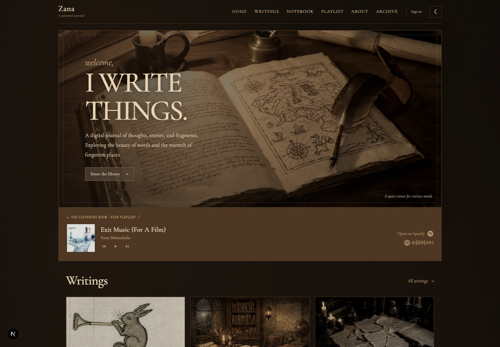

# Zana
A personal journal for essays, notebook entries, and ideas about philosophy,
science, technology, and creative work. The site pairs a warm, bookish visual
style with a working publishing backend: writing, comments, moderation, user
profiles, and a Spotify listening room.



## What’s here

- **Home and writing:** a featured introduction, recent posts, a notebook
  preview, and an about section.
- **Journal pages:** browse all writing, filter by category, search, open
  individual posts, or browse the archive.
- **Notebook:** a dedicated shelf for short entries and notes.
- **Community:** sign in, comment on posts, choose a username, and view public
  profiles.
- **Publishing and moderation:** write and publish posts, review submissions,
  manage users, and edit the about page.
- **Listening room:** Spotify embeds on the home and playlist pages. Admins can
  manage playlists and choose which one the homepage uses.
- **Responsive presentation:** mobile navigation, a theme switch, locally
  bundled fonts, and a layout designed for small and large screens.

## Run it locally

Requirements: Node.js 20.9 or newer and npm.

```bash
npm install
npm run dev
```

Open [http://localhost:3000](http://localhost:3000). On the first run, the
development command prepares a local SQLite database, generates the local
Prisma client, and seeds example posts and categories. Local preview data stays
in `prisma/local.db`; it does not require a PostgreSQL server.

The setup creates a local admin account. Find its generated password in
`prisma/local-admin.credentials` and sign in at `/login` with
`admin@local.test`. The credentials file is excluded from Git.

To reapply the local schema and seed content without deleting existing rows:

```bash
npm run db:local:setup
```

The site itself can run against the local database without external services.
Google and GitHub sign-in, Spotify playback and embeds, and external links need
an internet connection.

## Database and authentication

Without a PostgreSQL `DATABASE_URL`, the app uses the local SQLite preview
database. To use the PostgreSQL backend, set `DATABASE_URL` to a PostgreSQL
connection string before starting or building the app.

Google and GitHub sign-in use NextAuth. Configure the provider credentials
(`GOOGLE_CLIENT_ID`, `GOOGLE_CLIENT_SECRET`, `GITHUB_ID`, and `GITHUB_SECRET`)
and a `NEXTAUTH_SECRET` in the deployment environment. Set `NEXTAUTH_URL` to the
deployed site URL where required by your hosting setup. Never commit real
credentials or secrets.

Spotify playlist defaults can be supplied with
`NEXT_PUBLIC_SPOTIFY_PLAYLIST_URLS` (comma-separated playlist URLs) and
`NEXT_PUBLIC_SPOTIFY_PLAYLIST_TITLES` (matching comma-separated titles).
Playlists saved in the admin editor take precedence. The Spotify player uses
Spotify's official embeds and requires network access.

## Main pages

| Path | Purpose |
| --- | --- |
| `/` | Home, recent writing, notebook preview, and listening room |
| `/blog` | Browse and search writing |
| `/posts/[slug]` | Read a post and its comments |
| `/category/[slug]` | Browse a category |
| `/notebook` | Browse notebook entries |
| `/archive` | Browse older posts |
| `/playlist` | Listening room and playlist management |
| `/about` · `/contact` | About and contact pages |
| `/write` | Create and publish a post |
| `/profile` · `/u/[username]` | Account profile and public user pages |
| `/admin/moderation` · `/admin/users` | Moderation and user administration |

## Tests and checks

Run the unit tests:

```bash
npm test
```

Run the browser tests (install Chromium once first):

```bash
npx playwright install chromium
npm run test:e2e
```

The Playwright setup creates a separate test database under `.playwright/` and
uses its own Next.js output directory. It does not reset or write to
`prisma/local.db`.

Other project commands:

```bash
npm run lint
npm run build
npm start
```

## Project layout

```text
src/app/          Pages, layouts, and API routes
src/components/   Page sections and reusable UI
src/utils/        Database, authentication, and integration helpers
prisma/           PostgreSQL and local SQLite Prisma schemas
scripts/          Local database setup and seed scripts
tests/            Unit and Playwright browser tests
public/           Images, fonts, and other static assets
```

The journal photographs and self-hosted fonts are included in `public/`. Check
their individual licenses and attribution requirements before redistributing
those assets outside this project.
