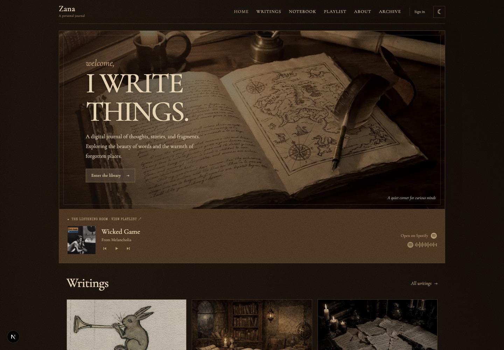
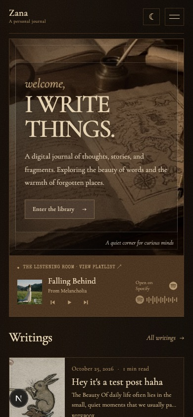
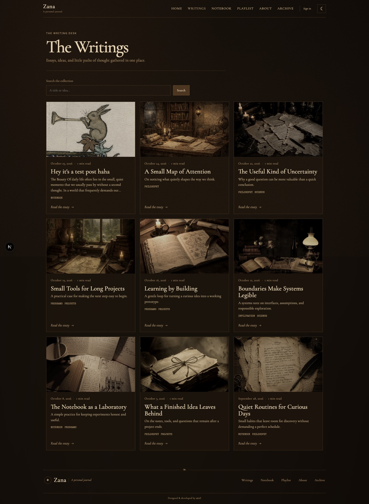
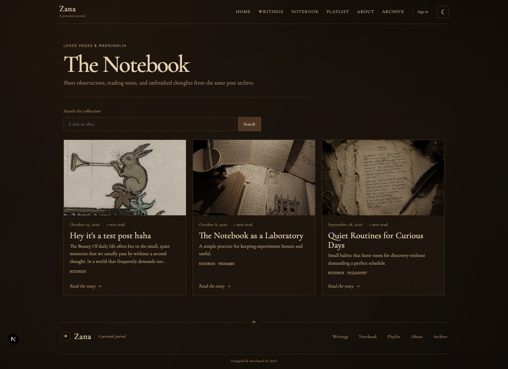
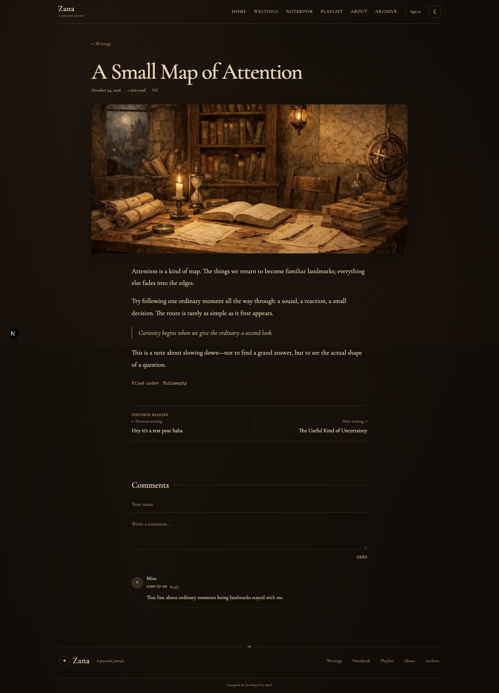
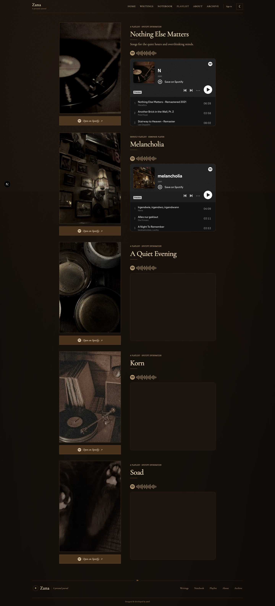
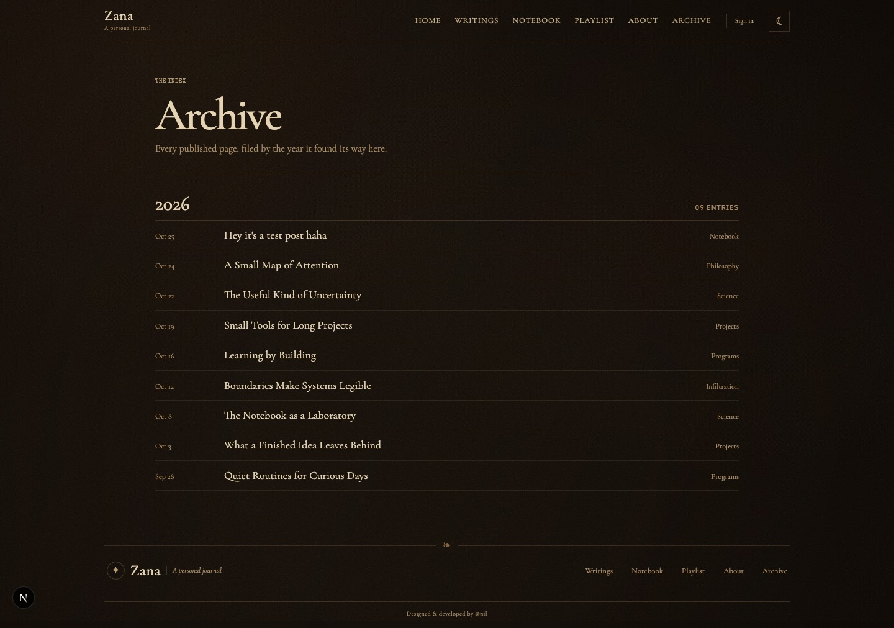

# Zana
A personal journal for essays, notebook entries, and ideas about philosophy,
science, technology, and creative work. It combines a responsive editorial
frontend with a publishing backend for posts, comments, accounts, and moderation.

## Screenshots

| Home — desktop | Home — mobile |
| --- | --- |
|  |  |

| Writing archive | Notebook |
| --- | --- |
|  |  |

| Article and comments | Spotify listening room |
| --- | --- |
|  |  |



## Features

- Responsive home, blog, notebook, category, archive, about, and contact pages.
- Search and browse published posts by category.
- Rich-text post creation, public profiles, usernames, and comments.
- Email/password, Google, and GitHub sign-in through NextAuth.
- Admin tools for post moderation, user management, playlist settings, and
  about-page content.
- Spotify listening room with playlist management and homepage playback
  controls.
- Light and dark themes, self-hosted fonts, and locally bundled site imagery.
- Local SQLite preview data for development without a PostgreSQL server.

## Technology

| Area | Tools |
| --- | --- |
| Web app | Next.js App Router, React |
| Data access | Prisma ORM |
| Databases | PostgreSQL backend, SQLite local preview |
| Authentication | NextAuth, Prisma adapter, bcrypt |
| UI | CSS Modules, global CSS, React Icons |
| Testing | Node.js test runner, Playwright |

## Run locally

Requirements: Node.js 20.9 or newer and npm.

```bash
npm install
npm run dev
```

Open [http://localhost:3000](http://localhost:3000). The development command
prepares the local Prisma client, creates `prisma/local.db`, and seeds example
posts and categories on first run. Local data is kept in SQLite, so a PostgreSQL
server is not needed to preview the site.

Local setup creates an admin account with the email `admin@local.test`. Its
generated password is saved in `prisma/local-admin.credentials`; use it to sign
in at `/login`. The credentials and local database files are excluded from Git.

To apply the local schema and seed content again without deleting existing
rows:

```bash
npm run db:local:setup
```

## Database and services

When `DATABASE_URL` is not a PostgreSQL URL, the app uses the local SQLite
database. To connect the PostgreSQL backend, set `DATABASE_URL` to your
PostgreSQL connection string before starting or building the app.

For Google and GitHub authentication, configure these environment variables:

```text
GOOGLE_CLIENT_ID
GOOGLE_CLIENT_SECRET
GITHUB_ID
GITHUB_SECRET
NEXTAUTH_SECRET
NEXTAUTH_URL
```

OAuth credentials and secrets belong in your local environment or deployment
provider, not in source control. Local preview generates its own auth secret.

Spotify playlist defaults can be set with comma-separated
`NEXT_PUBLIC_SPOTIFY_PLAYLIST_URLS` and matching
`NEXT_PUBLIC_SPOTIFY_PLAYLIST_TITLES`. Playlists configured in the admin editor
take precedence. Spotify embeds and playback need an internet connection;
the rest of the local preview uses bundled fonts and images.

## Routes

| Route | Description |
| --- | --- |
| `/` | Home, recent writing, notebook preview, and listening room |
| `/blog` | Search and browse writing |
| `/posts/[slug]` | Article and comments |
| `/category/[slug]` | Posts in a category |
| `/notebook` | Notebook entries |
| `/archive` | Chronological archive |
| `/playlist` | Spotify playlists and playlist settings |
| `/about`, `/contact` | About and contact pages |
| `/write` | Post editor |
| `/profile`, `/u/[username]` | Account and public profiles |
| `/admin/moderation`, `/admin/users` | Admin tools |

## Tests and commands

```bash
npm test                         # Unit tests
npx playwright install chromium  # Install browser once
npm run test:e2e                 # Browser tests
npm run lint                     # ESLint
npm run build                    # Production build
npm start                        # Run the production build
```

The Playwright server uses its own SQLite database under `.playwright/` and a
separate Next.js output directory; it does not reset or write to
`prisma/local.db`.

## Project structure

```text
src/app/          App Router pages, layouts, and API routes
src/components/   Page sections and reusable UI
src/utils/        Database, auth, and integration helpers
prisma/           PostgreSQL and local SQLite schemas
scripts/          Local database setup and seed scripts
tests/            Unit and Playwright browser tests
public/           Fonts, images, and static assets
```

## Deployment

Provide a PostgreSQL `DATABASE_URL` and the authentication credentials needed
for the enabled sign-in providers in the deployment environment. Build with
`npm run build`, then run with `npm start` or the equivalent commands for your
hosting platform. Set `NEXTAUTH_URL` to the deployed site URL and use a
production-only `NEXTAUTH_SECRET`.

Photographs and self-hosted fonts are included in `public/`. Check their
individual licenses and attribution requirements before redistributing those
assets outside this project.
